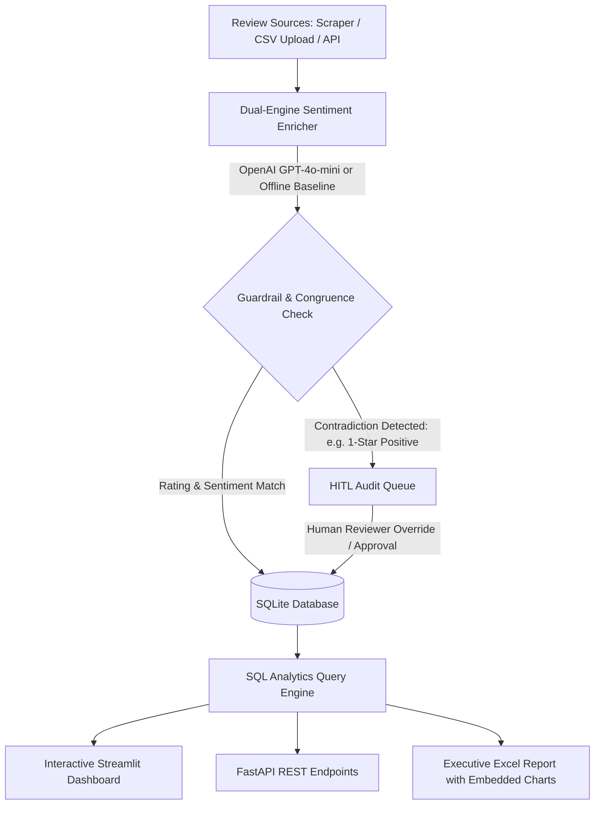

# AI-Powered Customer Feedback & Sentiment Analytics Pipeline (v2.0 Production Ready)

An end-to-end, enterprise-grade NLP and data analytics system that automates the collection, validation, enrichment, and visualization of customer feedback. 

Features **Multi-Engine Sentiment Analysis** (OpenAI GPT-4o-mini with deterministic baseline fallback), **Contradiction & Anomaly Detection**, **Aspect Evidence Extraction**, **Human-in-the-Loop (HITL) Quality Control**, a **FastAPI REST API**, an interactive **Streamlit Web Application**, and **Docker Containerization**.

---

## 🏗️ System Architecture Flow



---

## 🌟 What's New in Version 2.0 (Deployability & Enterprise Features)

| Feature | Description | File / Endpoint |
| :--- | :--- | :--- |
| **Interactive Web Application** | Streamlit UI with live single-review tester, batch CSV upload, interactive charts, and audit queue. | `app.py` (Port 8501) |
| **Production REST API** | High-performance FastAPI backend with Swagger docs, health probes, and batch endpoints. | `api.py` (Port 8000, `/docs`) |
| **Docker Containerization** | Multi-container setup orchestrating Streamlit frontend and FastAPI microservice. | `Dockerfile`, `docker-compose.yml` |
| **Defensive Anomaly Detection** | Detects semantic incongruence between star rating and predicted sentiment (e.g., sarcasm/hallucination). | `llm_sentiment_enricher.py` (`is_conflicted`) |
| **Evidence Extraction (ABSA)** | Extracts exact supporting text phrases justifying sentiment and suggested actions. | `evidence_quote` |
| **Human-in-the-Loop (HITL)** | Quarantines low-confidence/contradictory reviews for human auditor review & label override. | `app.py` Tab 4 & `/api/audit/override` |
| **Automated Test Suite** | Pytest coverage for heuristic engine, anomaly checks, database, and FastAPI endpoints. | `test_pipeline.py` |

---

## 🛠️ Tech Stack

- **Core & APIs:** Python 3.11, FastAPI, Uvicorn, Pydantic
- **Web UI & Visualization:** Streamlit, Matplotlib, Seaborn
- **AI & NLP:** OpenAI API (GPT-4o-mini structured JSON mode) with deterministic keyword fallback
- **Data & Storage:** Pandas, NumPy, SQLite3, OpenPyXL
- **Deployment & DevOps:** Docker, Docker Compose, Pytest

---

## 🚀 Deployment & Quick Start Guide

### 1. Local Environment Setup

```bash
# Clone the repository and navigate to the directory
cd feedback-analytics-pipeline

# (Optional) Create and activate virtual environment
python -m venv .venv
# Windows:
.\.venv\Scripts\activate
# Linux/macOS:
source .venv/bin/activate

# Install all dependencies
pip install -r requirements.txt
```

### 2. Configure Environment Variables (Optional)

```bash
# Copy example configuration
cp .env.example .env
```
Add your OpenAI key to `.env` or set it in your terminal:
```bash
# Windows PowerShell:
$env:OPENAI_API_KEY="sk-..."
# Linux/macOS:
export OPENAI_API_KEY="sk-..."
```
> **Note:** If no key is configured, the system automatically runs in deterministic heuristic mode with 0% crash risk.

---

### 3. Run the Services

#### Option A: Launch Interactive Streamlit Web Dashboard
```bash
streamlit run app.py
```
Open [http://localhost:8501](http://localhost:8501) to:
- Test live reviews and observe model confidence & contradiction warnings.
- Upload custom CSV review datasets.
- View real-time SQL KPI summaries and charts.
- Audit flagged reviews in the HITL verification queue.

#### Option B: Launch FastAPI REST Microservice
```bash
uvicorn api:app --reload --port 8000
```
Open interactive Swagger documentation at [http://localhost:8000/docs](http://localhost:8000/docs):
- `GET /health` — Service readiness probe
- `POST /api/analyze` — Real-time single review inference
- `POST /api/batch-analyze` — Batch review processing
- `GET /api/metrics` — Aggregated SQL KPI summaries
- `GET /api/audit-queue` — Contradiction audit queue
- `POST /api/audit/override` — Human label correction endpoint
- `GET /api/export/excel` — Download generated corporate Excel report

#### Option C: Run End-to-End Batch ETL Script
```bash
python main.py
```
Outputs:
- Populated database: `feedback_analytics.db`
- Styled spreadsheet: `customer_feedback_insights.xlsx`

---

### 4. Deploy with Docker & Docker Compose

Deploy the entire full-stack pipeline with a single command:

```bash
docker compose up --build
```
- **Streamlit Web UI:** `http://localhost:8501`
- **FastAPI Backend:** `http://localhost:8000`

---

## 🧪 Running Automated Tests

```bash
pytest test_pipeline.py -v
```
All tests verify heuristic accuracy, anomaly detection, database transactions, HITL overrides, and FastAPI endpoints.
