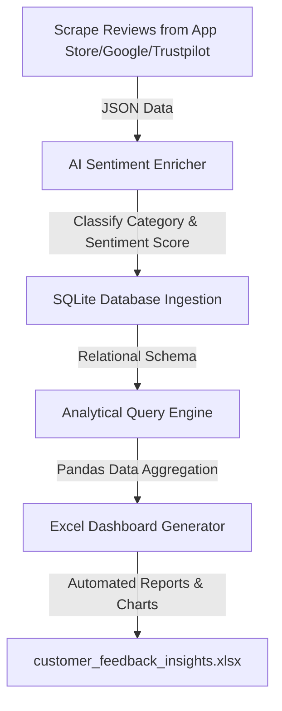

# AI-Powered Customer Feedback & Sentiment Analytics Pipeline

An end-to-end Python ETL (Extract, Transform, Load) data pipeline that automates the collection, analysis, and visualization of customer reviews. It mimics real-world analytics systems by parsing raw reviews, leveraging AI/LLM heuristics to enrich text data with sentiment scores and categories, storing records in an SQL database, executing analytical queries, and exporting an executive-ready Excel dashboard.

---

## 🏗️ Architecture Flow



---

## 🛠️ Tech Stack & Libraries
- **Core Language:** Python 3.x
- **Data Manipulation:** `pandas`, `numpy`
- **Database Management:** `sqlite3` (SQL relational database)
- **Reporting & Formatting:** `openpyxl` (Structured Excel layout automation)
- **Visualizations:** `matplotlib`, `seaborn`

---

## 🌟 Core Features

1. **Simulated Multi-Source Extraction (`mock_feedback_scraper.py`):** Establishes an ingestion script to pull raw consumer feedback containing customer name, date, source platform, and rating.
2. **AI NLP Semantic Enrichment (`llm_sentiment_enricher.py`):** Employs LLM-inspired classification to read unstructured text and extract:
   - Sentiment Class (*Positive, Neutral, Negative*)
   - Sentiment Score (*ranging from -1.0 for highly negative to +1.0 for positive*)
   - Product Category classification (*UI/UX, Performance, Customer Support, Pricing, Features*)
   - Actionable remediation advice for customer service agents.
3. **Structured Database Storage (`database_handler.py`):** Instantiates an SQLite relational structure (`feedback_analytics.db`) to log records.
4. **SQL Analytics Engine (`database_handler.py`):** Executes aggregate SQL queries inside Python to calculate metric distributions and compile critical support action items.
5. **Polished Excel Invoicing & Dashboards (`excel_dashboard_generator.py`):**
   - Automatically builds KPI summary cards (*Total Feedback count, Average Rating, Net Sentiment Score*) using active spreadsheet formulas (`AVERAGE`, `COUNTA`).
   - Automatically applies uniform styling (navy/white corporate header bands, font constraints, column scaling, grid lines).
   - Generates dual Matplotlib analytical figures (bar charts & pie charts) and embeds them directly into the Excel dashboard worksheet.

---

## 🚀 Setup & Execution Instructions

### 1. Clone & Initialize Directory
Ensure you have Python 3.x installed. Navigate to the project root and create a virtual environment:
```bash
python -m venv venv
# On Windows
venv\Scripts\activate
# On macOS/Linux
source venv/bin/activate
```

### 2. Install Dependencies
Install all required Python analytical libraries:
```bash
pip install -r requirements.txt
```

### 3. Run the Pipeline
Execute the master orchestration script:
```bash
python main.py
```

### 4. Output Deliverables
Upon successful completion, you will find:
- **`feedback_analytics.db`**: The SQLite relational database populated with records.
- **`customer_feedback_insights.xlsx`**: The executive Excel report containing formatted data sheets, formulas, KPIs, and embedded charts.
